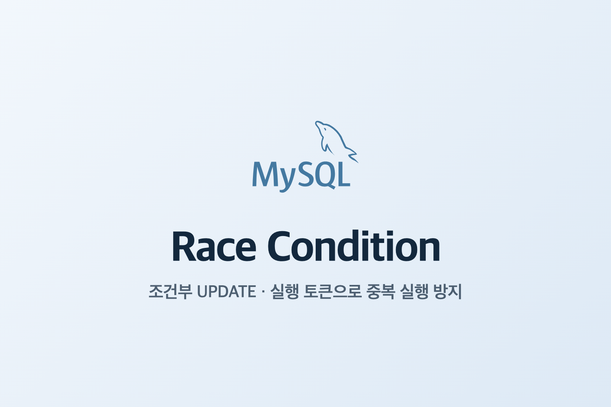
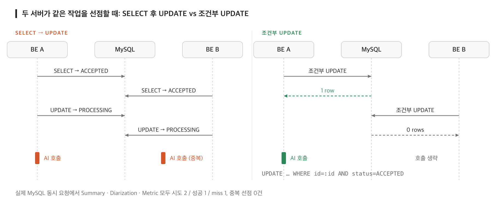
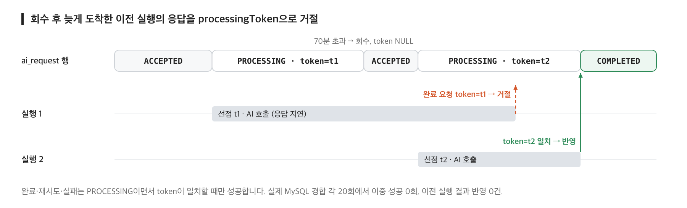

안녕하세요, Meety BE 개발자 Jay입니다.

Meety는 회의 종료 후 AI를 이용해 요약과 분석 결과를 생성합니다. AI 응답을 받을 때까지 HTTP 요청을 유지하는 대신, 작업 상태를 DB에 저장하고 백엔드 서버가 주기적으로 처리 대상을 가져옵니다.

BE 서버가 한 대라면 비교적 단순합니다. 그런데 BE를 여러 대로 늘리면 두 서버가 같은 작업을 가져갈 수 있고, 서버가 죽으면 작업이 멈출 수 있으며, 회수한 뒤에는 이전 실행의 응답이 늦게 도착할 수 있습니다. 이 세 문제를 차례로 해결한 과정과, 서버가 늘며 드러난 선점 경쟁을 SKIP LOCKED로 실험한 결과를 정리합니다.

## 여러 BE가 같은 ACCEPTED 요청을 조회하면?

AI 요청은 `ACCEPTED` 상태로 저장되고, 처리를 시작하면 `PROCESSING`으로 바뀝니다. BE A와 BE B가 같은 시점에 같은 작업을 조회하면 두 서버 모두 처리할 수 있다고 판단합니다. 같은 요약을 두 번 요청하거나 결과를 서로 덮어쓸 가능성이 생깁니다.

## SELECT 후 UPDATE가 갖는 경쟁 조건

```text
BE A: SELECT → status = ACCEPTED 확인
BE B: SELECT → status = ACCEPTED 확인
BE A: UPDATE → PROCESSING, AI 호출
BE B: UPDATE → PROCESSING, AI 호출   (중복)
```

확인과 변경이 나뉘어 있으면, 확인한 사실은 변경하는 시점에 이미 오래된 정보일 수 있습니다.



## synchronized나 ShedLock 대신 DB 조건부 UPDATE를 선택한 이유

- **synchronized:** 한 JVM 안에서만 동작하므로 서버 간 경쟁을 막지 못합니다.
- **ShedLock:** 스케줄러 실행 자체를 한 서버로 제한합니다. 하지만 필요한 것은 모든 서버의 실행을 막는 것이 아니라, 하나의 작업을 한 서버만 선점하도록 만드는 것이었습니다.
- **조건부 UPDATE:** 상태가 이미 DB에 있고, 한 행의 UPDATE는 DB가 순서를 정해 줍니다. 별도 인프라나 라이브러리 없이 작업 단위로 선점할 수 있습니다.

## ACCEPTED → PROCESSING Atomic Claim 구현

확인과 변경을 하나의 UPDATE로 합쳤습니다. 아래는 실제 쿼리에서 enum 경로만 줄인 것입니다.

```sql
update AiRequest a
set a.status = PROCESSING,
    a.processingToken = :processingToken,
    a.updatedAt = CURRENT_TIMESTAMP
where a.id = :id
  and a.status = ACCEPTED
```

반환된 `affectedRows`가 1이면 선점에 성공한 것이고 0이면 다른 서버가 먼저 가져간 것입니다. 0은 오류가 아니라 정상적인 경쟁 결과이므로 AI 호출만 생략합니다.

요약(Summary), 화자 분리(Diarization), 지표(Metric)에 모두 적용했고, AI HTTP 호출은 기존처럼 트랜잭션 밖에서 실행합니다. Bulk Update 후에는 영속성 컨텍스트와 어긋나지 않도록 자동으로 flush·clear합니다.

## 실제 MySQL 동시 요청으로 단일 선점 검증

```text
Summary:      시도 2 / 성공 1 / miss 1
Diarization:  시도 2 / 성공 1 / miss 1
Metric:       시도 2 / 성공 1 / miss 1
중복 선점 0건
```

## 서버가 죽으면 PROCESSING은 어떻게 되는가?

선점을 막았더니 다음 문제가 보였습니다. 선점한 서버가 처리 중에 죽으면 작업은 `PROCESSING`에 멈추고, 다른 서버는 이 작업을 가져갈 수 없습니다.

그래서 `updatedAt`을 기준으로 오래된 `PROCESSING`을 찾아 회수합니다.

```text
processing timeout: 70분
polling 주기: 1분
batch size: 100
재시도 가능: PROCESSING → ACCEPTED, retryCount + 1
재시도 한도 도달: PROCESSING → FAILED
```

회수도 조건부 UPDATE로 처리해 여러 서버가 같은 작업을 중복으로 회수하지 않게 했습니다. 실제 MySQL에서 같은 작업을 20번 동시에 회수해도 성공은 1건이었고 최종 `retryCount`는 1이었습니다. 한도에 도달한 작업의 실패 전환도 20번 시도 중 1건만 성공했습니다.

## stale 작업 회수 후 도착하는 이전 AI 응답

회수는 새로운 문제를 만듭니다. 회수된 작업의 이전 실행이 죽은 것이 아니라 느렸을 뿐일 수 있습니다.

```text
실행 1: 작업 선점, AI 호출 (응답 지연)
회수:   PROCESSING → ACCEPTED
실행 2: 같은 작업 선점, AI 호출
실행 1: 늦은 응답 도착 → status는 PROCESSING이므로 완료 처리 가능?
```

상태만 비교하면 실행 1과 실행 2를 구분할 수 없습니다. 이전 실행의 응답이 최신 상태와 결과를 덮어쓸 수 있습니다.

## processingToken으로 실행 세대 구분

선점할 때마다 UUID로 된 `processingToken`을 함께 기록합니다. 앞의 Claim 쿼리에 이 값이 들어 있는 이유입니다.

- 완료, 재시도, 실패 처리는 `PROCESSING` 상태이면서 현재 token이 일치할 때만 성공합니다.
- 회수할 때는 기존 token을 `NULL`로 초기화합니다.
- 요약 결과, 화자 매핑, 지표 결과는 현재 실행이 선점한 트랜잭션에서만 저장합니다.

이제 실행 1의 늦은 응답은 token이 다르므로 거절됩니다.



## 완료·재시도·복구 경합 테스트와 남은 한계

```text
실제 MySQL 경합 각 20회
Complete vs Recovery: 이중 성공 0회
Retry vs Recovery:    이중 성공 0회
Complete vs Retry:    이중 성공 0회
이전 실행 결과 반영: 0건
```

다만 한계도 남아 있습니다.

- **AI 호출 중복:** token은 결과 반영을 막을 뿐, 이미 보낸 AI 요청을 취소하지는 않습니다. 이전 실행이 살아 있다면 AI 자원이 두 번 쓰일 수 있습니다.
- **복구 시간:** 기준이 70분이므로 서버가 죽은 작업은 그만큼 기다린 뒤에야 회수됩니다.
- **검증 범위:** 위 결과는 동시성 통합 테스트이며, 운영 환경의 부하를 측정한 값은 아닙니다.

중복 선점을 막는 것으로 끝나지 않았습니다. 누가 작업을 가져가는지와 그 결과를 누가 반영할 수 있는지는 따로 다뤄야 하는 문제였습니다.

## 서버가 4대가 되자 보인 선점 경쟁

조건부 UPDATE로 중복 실행은 막았지만, 여러 서버가 같은 후보를 먼저 읽는 문제는 그대로였습니다. 늦게 온 서버는 이미 다른 서버가 가져간 작업에 UPDATE를 보내고 0행을 받습니다. 오류는 아니지만 헛걸음(Claim Miss)입니다.

BE 4대에서 요약 작업 100건을 한 번에 등록하자(Polling 1초, 한 번에 5건) Claim Miss가 평균 43건 났습니다. 선점 시도의 상당수가 헛걸음이었습니다.

## SELECT … FOR UPDATE SKIP LOCKED를 실험한 이유

`SKIP LOCKED`는 후보를 조회할 때 행을 잠그고, 다른 서버가 이미 잠근 행은 결과에서 빼고 돌려줍니다. 서버마다 처음부터 서로 다른 작업을 받게 되므로 같은 행을 두고 경쟁할 일이 없습니다. 실험에 쓴 형태를 단순화하면 다음과 같습니다.

```sql
SELECT id FROM ai_requests
WHERE request_type = 'SUMMARY' AND status = 'ACCEPTED'
ORDER BY id
LIMIT 5
FOR UPDATE SKIP LOCKED;
-- 같은 트랜잭션에서 PROCESSING·processingToken 기록 후 커밋
-- AI 호출은 트랜잭션 밖에서 실행
```

행 잠금은 상태를 바꾸는 짧은 트랜잭션 동안만 유지하고, AI 호출은 트랜잭션 밖에서 실행하도록 구성했습니다. 늦은 응답을 막는 processingToken 구조는 그대로 둡니다.

## 조건부 UPDATE와 SKIP LOCKED 비교

같은 조건(MySQL 8.4, ai_requests 100만 행, 요약 100건 Burst, 20ms AI Stub, Polling 1초)에서 BE 수를 1·2·4대로 바꾸며 두 방식을 3회씩 비교했습니다.

```text
BE 4대, 3회 평균 (조건부 UPDATE → SKIP LOCKED)
Claim Miss:          43건 → 0건
등록 → 선점 p95:      7.72초 → 5.26초
요약 전체 완료 시간:   8.06초 → 5.48초
완료 처리량:          12.50건/s → 18.26건/s
MySQL CPU:           0.071 core → 0.071 core
```

BE 1·2대에서는 경쟁이 없어 차이가 거의 없었고, 4대에서만 차이가 났습니다. DB CPU는 줄지 않았습니다. 얻은 것은 DB 자원 절감이 아니라 선점 경쟁과 지연의 감소였습니다. 18회 실행에서 3,600건 모두 한 번씩만 선점되고 완료됐습니다.

다만 두 방식은 한 번에 선점하는 건수(1건, 최대 5건)도 달라서, SKIP LOCKED 하나만의 효과로 보기는 어렵습니다. 그래도 서버가 늘수록 경쟁이 커진다는 점은 분명해서, SKIP LOCKED를 선점 방식의 적용 후보로 정했습니다. 운영 반영은 아래에서 설명할 메시지 큐 설계와 함께 결정하기로 했고, 현재 코드는 조건부 UPDATE 방식을 사용합니다.

## 1초 폴링은 충분했지만

인덱스를 둔 상태에서 폴링 주기를 5초에서 1초로 줄이자 작업 선점 p95가 4.64초에서 0.95초로 줄었고, DB CPU 증가는 뚜렷하지 않았습니다. 서버 간 경쟁도 SKIP LOCKED로 줄일 수 있음을 확인해, 지금 규모에서 DB 폴링 자체는 문제가 되지 않았습니다.

걸리는 곳은 AI 쪽이었습니다. 서버가 늘면 각 서버가 가져가는 작업도 함께 늘고, 그만큼 AI 서버로 동시에 들어가는 요청도 늘어납니다. 폴링 구조에서는 AI가 감당할 수 있는 양을 BE가 알 수 없습니다. 나중에 GPU 서버에서 LLM을 직접 서빙하면, 처리 용량을 넘는 요청이 그대로 AI로 몰릴 수 있습니다.

그래서 작업을 넘기는 쪽(BE)과 처리하는 쪽(AI)을 큐로 나누고, AI가 자기 처리 능력만큼만 가져가게 하는 메시지 큐(RabbitMQ) 도입이 필요하다고 느꼈습니다.
