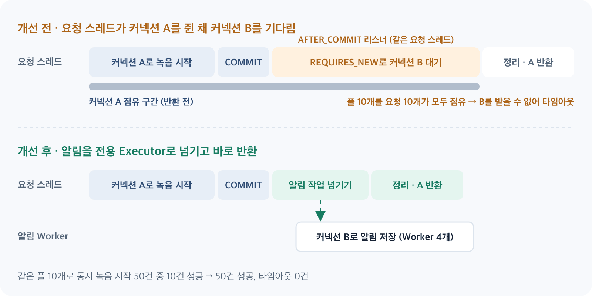

안녕하세요, Meety BE 개발자 Jay입니다.

50개 팀이 동시에 녹음을 시작하는 부하테스트에서 요청 대부분이 실패했습니다. HikariCP의 최대 커넥션 수는 10개였고, 동시 요청 50건 중 성공한 요청은 10건뿐이었습니다. 나머지 요청에서는 커넥션 획득 타임아웃이 발생했습니다.

가장 쉬운 답은 풀 크기를 늘리는 것이었습니다. 하지만 원인을 모른 채 풀을 늘리면 문제가 나타나는 지점만 뒤로 미루게 됩니다. 그래서 기능을 하나씩 나눠 원인을 좁혀 보기로 했습니다.

## 50개 팀 동시 녹음 테스트에서 발생한 커넥션 타임아웃

전체 회의 부하테스트에서는 SSE, 녹음 API, 오디오 WebSocket, AI 연결, 정리 요청이 동시에 실행됩니다. 그래서 어느 기능이 원인인지 바로 특정하기 어려웠습니다. 외부 AI의 영향을 제거하고 BE 기능을 하나씩 분리해 테스트했습니다.

## 첫 번째 의심: SSE 연결이 DB 커넥션을 점유하는가?

오래 유지되는 연결이 DB 커넥션을 붙잡고 있다면 풀이 빠르게 고갈될 수 있습니다. 그래서 SSE 연결만 1, 50, 100, 300개로 늘려 봤습니다.

```text
SSE 300개 단독 연결
성공 300 / 실패 0
P99 331.02ms
Hikari Pending 0 / Timeout 0
```

같은 문제는 재현되지 않았습니다. 첫 번째 가설은 틀렸습니다.

## 녹음 시작 API만 분리해 재현

다음으로 SSE, 오디오·AI WebSocket, 오디오 청크, 녹음 종료를 모두 제외하고 녹음 시작 API만 테스트했습니다. 각 요청은 서로 다른 팀과 회의를 사용해 Row Lock 경합이 생기지 않게 했습니다.

```text
동시 30 → 10 성공 / 20 실패
동시 50 → 10 성공 / 40 실패
Hikari Pool 최대 10 도달, Connection acquire timeout, P99 약 30초
```

실시간 연결이 없어도 같은 증상이 재현됐습니다. 로그에서도 Row Lock보다 커넥션 획득 대기가 지배적이었습니다. 문제는 녹음 시작 API 안에 있었습니다.

## AFTER_COMMIT과 REQUIRES_NEW에서 추가 커넥션이 필요한 이유

녹음 시작 트랜잭션은 `RecordingStartedEvent`를 발행합니다. 알림 리스너는 이를 `AFTER_COMMIT`에서 받고, 알림 저장은 원본 트랜잭션과 분리하기 위해 `REQUIRES_NEW`로 실행합니다.

```java
@TransactionalEventListener(phase = TransactionPhase.AFTER_COMMIT)
public void createMeetingStartedNotification(...) { ... }

@Transactional(propagation = Propagation.REQUIRES_NEW)
public void create(...) { ... }
```

핵심은 **DB COMMIT과 JDBC 커넥션이 풀로 반환되는 시점이 같지 않다**는 점입니다. `AFTER_COMMIT` 리스너는 COMMIT 이후, 리소스 정리가 끝나기 전에 같은 요청 스레드에서 동기적으로 실행됩니다.

```text
요청 스레드
1. 커넥션 A 획득, 녹음 시작 처리
2. DB COMMIT
3. AFTER_COMMIT 리스너 실행        (커넥션 A 아직 반환 전)
4. REQUIRES_NEW가 커넥션 B 요청     (최대 30초 대기)
5. 리스너 종료 후 트랜잭션 정리
6. 커넥션 A 반환
```

풀이 10개일 때 동시 요청 10개가 커넥션을 모두 잡으면, 각 스레드는 기존 커넥션을 돌려주지 못한 채 추가 커넥션을 기다립니다. 뒤에 들어온 요청들도 같은 풀을 기다리다 타임아웃으로 실패합니다.

## Pool 크기 확대 대신 알림 실행 구조를 분리한 이유

풀을 늘리면 이 테스트는 통과할 수 있어도, 요청 하나가 커넥션 두 개를 필요로 하는 구조는 그대로 남습니다. 그래서 `maximumPoolSize=10`은 바꾸지 않고 알림 리스너를 전용 Executor로 분리했습니다.

```java
@Async(AsyncConfig.NOTIFICATION_TASK_EXECUTOR_BEAN_NAME)
@TransactionalEventListener(phase = TransactionPhase.AFTER_COMMIT)
public void createMeetingStartedNotification(...) { ... }
```

`@Async`가 커넥션을 직접 반환하는 것은 아닙니다. 알림 작업을 넘기면서 요청 스레드가 리스너에서 빠져나오고, 트랜잭션 정리를 이어가 커넥션을 반환할 수 있게 된 것입니다. 알림 Worker가 커넥션을 기다려도 요청 스레드의 정리는 더 이상 막히지 않습니다.



기존 `applicationTaskExecutor`는 AI 채팅도 사용하므로, 부하를 분리하고 알림의 DB 동시 실행량을 제한하기 위해 전용 Executor를 두었습니다.

## Worker 2·4·8개 비교 실험

Worker 1·2·4·8은 모두 타임아웃이 사라졌습니다. 한 번의 측정으로 정하지 않고 2·4·8을 각각 5회 반복했습니다.

```text
                     Worker 2    Worker 4    Worker 8
녹음 시작            5/5 50/50   5/5 50/50   5/5 50/50
P95 Median           136.90ms    110.15ms    112.33ms
P99 Median           139.36ms    111.82ms    113.57ms
P99 Max              146.54ms    141.18ms    123.18ms
Hikari Pending Max   0           0           0
Timeout              0           0           0
Drain Median         62ms        62ms        60ms
```

알림 수신자를 팀당 1명에서 5명으로 늘린 테스트에서도 알림 250건이 모두 저장됐고, Worker 8이 4보다 나은 결과를 보이지는 않았습니다(P99 Median 126.32ms와 122.09ms). 여기서 5명은 서비스 정책이 아니라 테스트 값입니다.

그래서 Worker 4를 선택했습니다. 가장 큰 값이 아니라, 요구 성능을 만족하면서 DB 커넥션 경쟁의 여유를 더 남기는 값입니다.

```text
corePoolSize = 4
maxPoolSize = 4
queueCapacity = 100
RejectionPolicy = AbortPolicy
```

## 10/50건에서 50/50건으로

커넥션 풀 크기는 그대로 10개입니다. 동시 녹음 시작 50건 중 10건만 성공하던 테스트가 50건 모두 성공했고, 타임아웃은 0건이 됐습니다. 처리량을 늘린 것이 아니라, 원본 커넥션을 잡은 채 추가 커넥션을 기다리는 구조를 없앤 결과입니다.

## 비동기 알림 처리의 남은 한계

- **큐 포화:** 테스트에서 큐 최대 관측값은 약 46으로 포화되지 않았습니다. `AbortPolicy`의 거절 경로까지 검증한 것은 아닙니다.
- **더 큰 규모:** 100, 300, 500, 1000건 규모의 용량 테스트와 그에 따른 풀 크기 재검토는 별도 범위로 나눴습니다.
- **AI 포함 검증:** 이 결과는 외부 AI를 제외한 BE 단독 테스트입니다. AI를 포함한 전체 처리 한계를 보여 주지는 않습니다.

이번 작업에서 얻은 가장 큰 교훈은, 설정값을 늘리기 전에 문제를 기능 단위로 나눠 보는 것이 원인을 찾는 가장 빠른 길이라는 점입니다.

## 참고

- [Issue #238](https://github.com/100-hours-a-week/KTB4-6th-BE/issues/238): BE 단독 부하테스트를 통한 DB Connection Pool 병목 구간 검증
- [PR #246](https://github.com/100-hours-a-week/KTB4-6th-BE/pull/246): 알림 이벤트 전용 비동기 워커 4개 적용
- [PR #261](https://github.com/100-hours-a-week/KTB4-6th-BE/pull/261): 알림 전용 Executor 설정 분리
