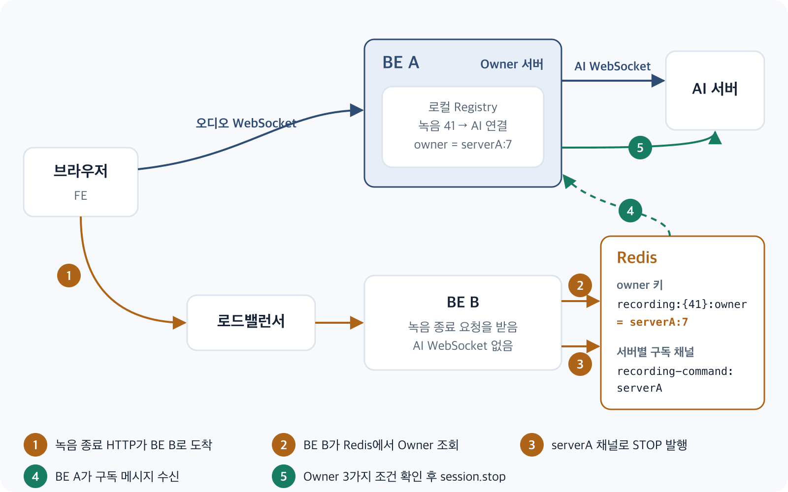
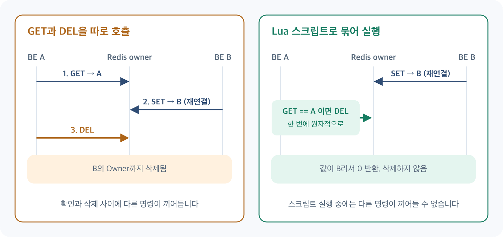

안녕하세요, Meety BE 개발자 Jay입니다.

BE A가 AI 서버와 WebSocket을 연결하고 있습니다. 그런데 사용자가 녹음 종료 버튼을 누르자 그 HTTP 요청은 BE B로 들어갑니다. BE B는 DB의 녹음 상태를 바꿀 수는 있지만, 정작 AI 서버에 종료 메시지를 보낼 WebSocket은 가지고 있지 않습니다.

그렇다면 BE B는 어떤 서버에 종료 명령을 전달해야 할까요?

이 글은 이 질문에 답하기 위해 팀에서 도입한 Redis Owner 구조를 다룹니다. 어떤 대안을 비교했는지, Owner는 왜 분산락이 아닌지, 그리고 이 구조로도 해결하지 못한 문제는 무엇인지 차례로 정리했습니다.



## Meety의 실시간 녹음은 어떻게 동작하는가?

Meety는 회의 중 사용자의 음성을 실시간으로 받아 AI 서버에 전달하고, 전사 결과를 참여자들에게 보여주는 서비스입니다. 녹음 하나에는 두 개의 WebSocket이 연결됩니다.

- **브라우저 ↔ BE:** 오디오 청크를 받는 연결
- **BE ↔ AI:** 오디오 청크를 전달하고 일시정지·재개·종료 같은 제어 메시지를 보내는 연결

처음에는 하나의 BE 서버가 두 연결을 모두 관리했습니다. 연결 정보를 메모리에 보관해도 문제가 없었습니다. 그 서버가 모든 요청과 연결을 가지고 있었기 때문입니다.

## BE 서버가 여러 대가 되면서 생긴 문제

BE를 두 대로 늘리자 이 전제가 깨졌습니다. 오디오는 WebSocket으로 흐르지만, 일시정지·재개·종료는 일반 HTTP 요청으로 들어옵니다. 그래서 로드밸런서가 이 요청을 어느 서버로 보내든, WebSocket을 가진 서버로 간다는 보장이 없습니다.

요청을 받은 서버가 해야 할 일은 두 가지로 나뉩니다.

1. DB의 녹음 상태를 변경한다. 이 일은 어느 서버든 할 수 있습니다.
2. AI WebSocket으로 제어 메시지를 보낸다. 이 일은 연결을 가진 서버만 할 수 있습니다.

## 로컬 메모리의 Registry만으로 해결할 수 없었던 이유

각 서버는 자신이 가진 AI 연결을 메모리의 Registry에 보관합니다. 하지만 이 Registry는 자기 서버의 연결만 알고 있습니다. BE B가 자기 Registry를 조회하면 "여기에는 없다"는 사실만 알 수 있을 뿐, 어느 서버에 있는지는 알 수 없습니다.

WebSocket 연결 객체 자체는 다른 서버와 공유할 수 없습니다. 실제 연결은 계속 각 서버의 메모리에 두어야 합니다. 그래서 공유할 대상을 연결이 아니라 **"이 녹음을 어느 서버의 어떤 연결이 맡고 있는가"라는 정보**로 좁혔습니다.

## Sticky Session, DB, Redis 중 무엇을 선택할까?

**Sticky Session**은 정상 상황에서는 같은 사용자의 요청을 같은 서버로 보내는 데 도움이 됩니다. 하지만 담당 서버에 장애가 나면 failover 문제를 해결하지 못합니다. 라우팅으로 문제를 피할 뿐, 다른 서버가 담당 서버를 알아낼 방법을 주지는 않습니다.

**DB에 Owner를 기록**하면 조회는 가능합니다. 하지만 담당 서버가 죽었는지 판단하려면 만료 시각을 직접 관리하고, 주기적인 갱신 쓰기를 트랜잭션 DB에 계속 보내야 합니다.

**Redis**는 TTL을 기본으로 제공하므로 "주기적으로 갱신하지 않으면 사라지는 소유권"을 자연스럽게 표현할 수 있습니다. 서버 간 명령 전달에 쓸 Pub/Sub도 함께 제공합니다.

그래서 실제 연결은 각 서버에 두고, Redis에는 소유자 정보와 복구에 필요한 최소한의 상태만 공유하기로 했습니다.

## Redis Owner Key와 Lease 설계

Redis에는 다음 두 키를 저장합니다.

```text
recording:{recordingSessionId}:owner     →  {serverId}:{connectionId}   TTL 30초, heartbeat로 연장
recording:{recordingSessionId}:sequence  →  마지막으로 AI에 전달한 순번   TTL 90분, 저장할 때마다 재설정
```

키의 중괄호는 Redis Cluster의 hash tag입니다. 같은 녹음의 두 키를 같은 슬롯에 배치해, 뒤에서 나올 Lua 스크립트가 두 키를 함께 다룰 수 있게 합니다.

Owner 값이 `serverId`만이 아니라 `serverId:connectionId`인 데에도 이유가 있습니다.

- `serverId`는 서버가 시작할 때 생성하는 UUID로, 명령을 보낼 서버를 찾는 데 씁니다.
- `connectionId`는 서버 안에서 Owner를 기록할 때마다 증가하는 값으로, 같은 서버 안의 이전 Owner와 현재 Owner를 구분합니다.

같은 서버에서 AI 연결을 재사용하더라도 새 `connectionId`를 받습니다. 그래서 이전 시점의 Owner를 들고 있는 작업은 값이 일치하지 않아 현재 Owner를 건드릴 수 없습니다.

Owner는 브라우저 WebSocket을 승인하기 직전에 기록합니다.

```text
사용자 인증 및 녹음 상태·권한 검증
→ AI 연결 생성 또는 재사용 및 준비
→ Redis Owner 기록
→ 로컬 AI 연결에 같은 Owner 값 보관
→ Redis sequence와 메모리 순번을 비교해 큰 값 반영
→ 브라우저 WebSocket 승인(101)
```

AI 연결이 준비되지 않았거나 Redis 기록에 실패하면 `503`을 반환하고 연결을 승인하지 않습니다. 명령을 받을 수 없는 서버가 Owner로 기록되거나, 다른 서버가 찾을 수 없는 녹음이 시작되는 상황을 막기 위해서입니다.

### Redis Owner는 분산락이 아닙니다

이 부분이 설계에서 가장 오해하기 쉬운 지점입니다. Owner를 처음 기록하는 코드는 조건 없는 `SET`입니다.

```java
public void save(Long recordingSessionId, String owner) {
    redisTemplate.opsForValue().set(RecordingRedisKeys.owner(recordingSessionId), owner, properties.ttl());
}
```

`SET NX`가 아니므로 이미 Owner가 있어도 새 값으로 덮어씁니다. 분산락이라면 다른 서버의 획득을 막아야 하지만, Owner는 **마지막으로 핸드셰이크에 성공한 연결**을 가리킵니다.

이 덮어쓰기는 의도된 동작입니다. 브라우저가 다른 서버로 재연결했을 때 이전 Owner의 TTL이 끝나기를 기다리지 않고 바로 이어서 녹음해야 하기 때문입니다.

대신 대가가 있습니다. 덮어쓴다고 이전 서버의 AI 연결이 자동으로 닫히지는 않습니다. 이전 서버는 자신이 밀려났다는 사실을 Redis 값을 비교해 봐야 알 수 있습니다. 그래서 갱신, 삭제, 명령 실행의 모든 단계에서 Owner 일치 여부를 확인합니다.

## TTL·Heartbeat·Owner 일치 조건은 왜 필요한가?

**TTL**은 서버가 정리 작업을 하지 못하고 죽어도 Owner 키가 영원히 남지 않게 합니다.

**Heartbeat**는 살아 있는 연결의 TTL을 10초마다 연장합니다. TTL이 30초이므로 한두 번 갱신에 실패해도 Owner가 바로 사라지지는 않습니다. 일시정지 중이거나 종료 응답을 기다리는 동안에도 연장합니다.

**Owner 일치 조건**은 갱신과 삭제를 Lua 스크립트로 묶어 원자적으로 처리합니다.

```java
private static final RedisScript<Long> DELETE_IF_OWNER = RedisScript.of("""
        if redis.call('GET', KEYS[1]) == ARGV[1] then
            return redis.call('DEL', KEYS[1], KEYS[2])
        end
        return 0
        """, Long.class);
```

`GET`과 `DEL`을 따로 호출하면 다음과 같은 문제가 생길 수 있습니다.

1. BE A가 `GET`으로 자신이 Owner임을 확인합니다.
2. 그 사이 브라우저가 BE B로 재연결해 Owner가 B로 바뀝니다.
3. BE A가 `DEL`을 실행해 **BE B의 Owner를 삭제**합니다.

Lua 스크립트는 Redis에서 원자적으로 실행되므로 이 사이에 다른 명령이 끼어들 수 없습니다. 갱신 스크립트도 같은 구조입니다. 값이 다르거나 키가 없으면 `0`을 반환하므로, 밀려난 서버가 TTL을 연장하거나 이미 만료된 Owner를 되살리는 일이 없습니다.



Owner와 sequence 삭제는 정상 종료 경로에서만 실행합니다. 녹음 중 AI 오류가 나거나 `session.ended` 없이 연결이 닫히면 삭제하지 않고 TTL로 만료되게 둡니다.

## Redis Pub/Sub을 이용한 녹음 제어 요청 전달

이제 BE B는 누구에게 명령을 보내야 할지 알 수 있습니다. 전달 경로는 다음과 같습니다.

```text
[요청 서버]  DB 상태 변경·커밋 → Redis Owner 조회 → recording-command:{serverId}로 발행
[Owner 서버] 수신 → Owner 검증 → AI 명령 실행
```

각 서버는 시작할 때 자기 `serverId` 채널을 구독합니다. 요청 서버 자신이 Owner여도 같은 경로로 발행해 처리 경로를 하나로 유지합니다.

명령에는 요청 서버가 조회한 `owner` 값이 함께 담깁니다. Owner 서버는 다음 조건을 모두 만족할 때만 명령을 실행합니다.

1. 로컬에 해당 녹음의 AI 연결이 있다.
2. 메시지의 Owner가 로컬 AI 연결의 Owner와 같다.
3. 현재 Redis의 Owner가 메시지의 Owner와 같다.

조회와 실행 사이에 재연결이 일어나 Owner가 바뀌었을 수 있기 때문입니다. 조건이 맞지 않으면 오래된 명령으로 보고 실행하지 않습니다.

Owner가 없을 때는 명령마다 처리가 다릅니다. `PAUSE`와 `RESUME`은 DB 상태만 변경합니다. `STOP`은 WebSocket이 연결되기 전에 종료한 경우로 보고, 요청 서버가 전사 확정 이벤트를 바로 발행합니다.

## 두 대의 BE로 검증한 소유권 변경과 제어 흐름

로컬 BE 서버 두 대와 Mock AI 서버로 다음 시나리오를 확인했습니다.

**시나리오 1: A에서 녹음하다 B로 재연결**

- B가 Redis의 sequence를 읽어 `recovery.start`를 25로 보냈습니다.
- 이미 처리한 중복 청크 5개를 버렸습니다.
- Owner가 B로 바뀌었습니다.

**시나리오 2: 45초 녹음**

- 녹음 중 Owner TTL이 20~27초로 유지됐습니다.
- 종료 후 Owner와 sequence 키가 모두 삭제됐습니다.

**시나리오 3: A에서 녹음하고 제어 요청은 B로 전송**

- 일시정지·재개·종료를 B로 요청했고, A가 AI에 `session.pause`, `resume`, `stop`을 실행했습니다.
- 브라우저 WebSocket은 코드 1000으로 정상 종료됐습니다.
- B는 요약을 등록하지 않았습니다.

다만 이 결과는 정상 흐름을 로컬에서 Mock AI로 검증한 것입니다. 실제 AI 서버와 운영 환경의 부하까지 검증했다는 의미는 아닙니다.

## 여전히 남은 문제: TTL 만료와 Redis 장애

Redis Owner는 "누구에게 보낼 것인가"라는 문제를 해결했지만, 다음 문제들은 이 단계의 범위 밖에 있었습니다.

**이전 서버를 막지는 못합니다.** Owner가 B로 바뀌어도 A의 AI 연결은 자동으로 닫히지 않습니다. 이 연결은 AI 서버의 연결 상한을 계속 차지합니다. 또한 Owner 검증은 제어 명령과 갱신·삭제에만 적용되므로, 서버 간 sequence 쓰기 충돌까지 막아 주지는 않습니다. 이 단계의 구조에는 분산 환경 전체에서 이전 Owner를 차단하는 fencing이 없습니다.

**TTL 만료와 "연결 전"을 구분하지 못합니다.** 연결이 살아 있는데 Redis 문제로 갱신이 밀려 Owner가 만료될 수 있습니다. Heartbeat는 만료된 Owner를 다시 만들지 않습니다. 이 상태에서 `STOP`이 들어오면 요청 서버는 Owner가 없으니 연결 전 종료로 판단하므로, 실제 AI 연결에는 종료 명령이 전달되지 않습니다.

**Pub/Sub은 메시지를 보장하지 않습니다.** 발행 시점에 구독자가 끊겨 있으면 메시지는 사라집니다. DB는 이미 `COMPLETED`로 커밋됐는데 `STOP`이 실행되지 않으면, 사용자에게는 끝난 녹음이 서버에서는 끝나지 않은 상태가 됩니다.

**Redis 자체의 장애도 남아 있습니다.** Redis가 멈추면 Owner 조회도, 명령 발행도 실패합니다.

정리하면, Redis Owner는 정상 흐름에서 요청과 연결이 서로 다른 서버에 있는 문제를 해결한 구조입니다. 장애 상황까지 해결한 구조는 아닙니다.

이어지는 글에서는 Redis 장애 중 유실된 `STOP`을 어떻게 보정했는지 다루겠습니다.

## 참고

- [PR #265](https://github.com/100-hours-a-week/KTB4-6th-BE/pull/265): 오디오 WebSocket 핸드셰이크에서 Redis Owner 기록
- [PR #266](https://github.com/100-hours-a-week/KTB4-6th-BE/pull/266): 오디오 sequence를 Redis에 저장하고 핸드셰이크에서 복원
- [PR #267](https://github.com/100-hours-a-week/KTB4-6th-BE/pull/267): 녹음 세션 Owner heartbeat로 갱신 및 정상 종료 시 해제
- [PR #268](https://github.com/100-hours-a-week/KTB4-6th-BE/pull/268): 녹음 제어 명령의 서버별 Redis 채널로 Owner 서버 전달
- [PR #269](https://github.com/100-hours-a-week/KTB4-6th-BE/pull/269): Redis Owner 구조 설계 및 구현
