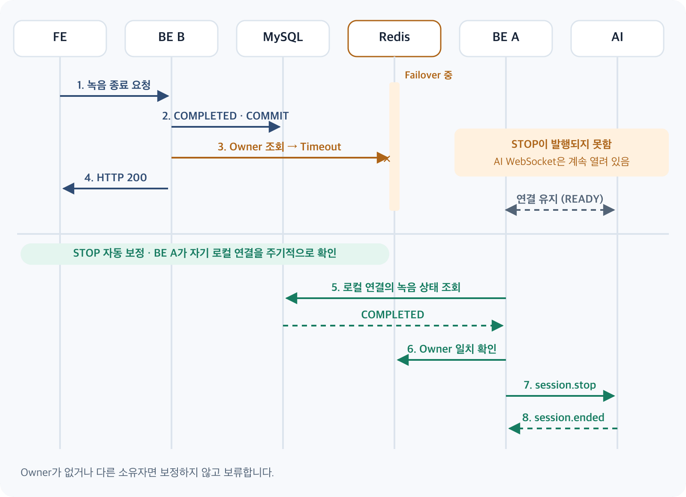

안녕하세요, Meety BE 개발자 Jay입니다.

Meety는 Redis를 이용해 여러 BE 서버 사이에서 녹음 Owner와 오디오 ACK를 관리하고, 녹음 제어 명령을 전달합니다.

처음에는 Redis Master에 장애가 발생해도 Replica가 승격되면 녹음 기능도 다시 정상으로 동작할 것이라고 예상했습니다. 이를 확인하려고 Redis Master 1대, Replica 1대, Sentinel 3개로 로컬 환경을 구성하고 녹음 중에 Master를 종료했습니다.

Sentinel은 약 5.8초 만에 Master를 전환했고, BE에서도 약 6.5초 후 Redis 작업이 다시 성공했습니다. 그런데 다중 서버 환경에서 녹음 종료를 요청하자 예상하지 못한 문제가 나타났습니다. 사용자에게는 종료가 성공했다고 응답했고 MySQL에도 종료로 기록됐지만, AI WebSocket은 그대로 연결되어 있었습니다.

Redis 서버가 복구되는 것과 녹음 기능이 정상화되는 것은 다른 문제였습니다.

## Redis가 죽으면 Meety 녹음에는 무슨 문제가 생기는가?

Redis는 녹음에서 세 가지 일을 합니다.

- **Owner:** 이 녹음의 AI WebSocket을 어느 서버의 어떤 연결이 가졌는지 기록합니다.
- **Audio ACK Checkpoint:** 복구 기준이 되는 순번을 저장합니다.
- **Pub/Sub:** 일시정지·재개·종료 명령을 Owner 서버로 전달합니다.

Redis가 막히면 다른 서버는 Owner를 찾지 못하고, FE로 보낼 ACK도 막히며, 제어 명령도 전달되지 않습니다.

## Standalone, Replica, Sentinel, Cluster 중 왜 Sentinel을 검토했는가?

- **Standalone:** 그 한 대가 단일 장애점입니다.
- **Master–Replica:** 데이터 복제본은 생기지만 승격은 자동으로 일어나지 않습니다.
- **Sentinel:** 장애 감지, Replica 승격, 새 Master 안내를 맡습니다.
- **Cluster:** 데이터 분산까지 해결하지만, 지금 확인하려는 자동 장애 전환보다 범위가 넓습니다.

그래서 자동 장애 전환을 검증할 대상으로 Sentinel을 골랐습니다. 로컬 실험은 Redis 7.4.10 Master 1, Replica 1, Sentinel 3(quorum 2)과 모의 FE, Fake AI로 진행했습니다.

## 실험 A: Master 장애와 Replica 승격

먼저 인프라 복구와 녹음 흐름 재개를 나눠 확인했습니다.

```text
Master 장애 → Sentinel 전환        약 5.8초
장애 주입 → BE 첫 Redis 작업 성공   약 6.5초
스트리밍 중 장애 시 FE ACK 공백      7.025초
재개 후 최종 FE ACK                700
전사 조회                            70건
```

70초 녹음 중 Master를 종료해도 Owner가 유지됐고, 녹음 흐름은 재개돼 종료까지 성공했습니다. 다만 측정 시작점이 서로 다르므로 이 값들을 직접 비교할 수는 없습니다.

## 실험 B: Owner Key만 사라지는 경우

이 실험은 Failover와 다릅니다. Redis가 정상인 상태에서 Owner Key만 강제로 삭제했습니다.

- Heartbeat는 Key를 다시 만들지 않았습니다.
- FE ACK가 100에서 멈춘 반면, AI ACK와 전사는 계속됐습니다.
- STOP이 전달되지 않아 DB만 `COMPLETED`가 되고 AI WebSocket은 남았습니다.

Sentinel이 Owner를 삭제한다는 뜻은 아닙니다. Redis가 정상이어도 소유권 정보가 사라지면 기능이 실패할 수 있다는 뜻입니다.

## 실험 C: Redis 복구 후에도 STOP이 전달되지 않는 경우

BE A가 AI WebSocket을 가지고 BE B가 종료 요청을 받는 상황입니다.

```text
FE → BE B: 녹음 종료 요청
BE B → MySQL: COMPLETED 저장, COMMIT
BE B → Redis: Owner 조회 → Timeout
BE B → FE: HTTP 200
BE A ↔ AI: STOP을 받지 못해 연결 유지
```

여기서 원인을 정확히 구분해야 합니다. Pub/Sub으로 발행한 메시지가 유실된 것이 아니라, Owner 조회가 Timeout되어 STOP이 **발행되지도 못한** 것입니다.

이미 커밋된 DB는 되돌리지 않으며, BE B만 Redis에서 끊은 실험에서는 Redis가 복구된 뒤에도 AI 연결이 최소 2분 16초 열려 있었습니다. Redis가 복구돼도 발행되지 못한 명령을 누군가 다시 처리해 주지는 않기 때문입니다.

## 해결 과정: STOP 자동 보정

AI 연결을 가진 BE가 자신의 로컬 연결과 DB 상태를 주기적으로 비교하도록 했습니다. 모든 녹음을 스캔하지 않고 로컬 연결만 100개씩 조회합니다.



```text
로컬 활성 AI 연결 조회
→ MySQL Primary의 녹음 상태 확인
→ COMPLETED인가?
→ Redis Owner가 현재 로컬 연결과 일치하는가?
→ 연결 세대와 중복 종료 여부 확인
→ 기존 STOP 경로 실행
→ AI session.ended
```

Outbox나 서버 간 직접 HTTP도 검토했습니다. 하지만 Redis 없이 연결을 가진 서버를 찾아야 하는 문제가 남아, 기존 경로를 재사용하는 이 방식을 골랐습니다.

```text
로컬 두 BE + Fake AI, DB 종료 → AI session.ended
Redis Master 장애 중 STOP 누락   약 7.44초
BE B만 Redis 단절 중 STOP 누락  약 0.66초
```

0.66초는 항상 1초 안에 복구한다는 뜻이 아닙니다. Polling 기본 주기가 3초인 조건에서 관측한 개별 결과이며, 반복 실험의 평균도 아닙니다.

또한 Owner Key가 없거나 다른 소유자로 바뀐 경우에는 임의로 STOP을 실행하지 않고 보류합니다. 이후에는 Redis 명령 대기 시간을 기본 3초로 제한하고, Redis 연결 장애로 Owner를 조회할 수 없을 때는 로컬 연결을 다시 검증한 뒤 제한적으로 보정하도록 개선했습니다.

## 한계와 회고

- **기능 기본값:** STOP 보정은 기본 OFF이며 환경별로 켜야 합니다. DB 조회 비용도 아직 측정하지 않았습니다.
- **Owner Key 유실:** Owner가 사라지면 안전하게 소유권을 확인할 수 없으므로 보정하지 않습니다.
- **비동기 복제와 명령 유실:** Replica로 복제되지 못한 최신 쓰기의 유실, Pub/Sub의 비영속 전달, 전역 Owner fencing은 별도 검증 대상입니다.
- **일시정지·재개:** PAUSE와 RESUME도 개별적으로 유실되는 것을 확인했지만, 이 보정의 대상은 STOP입니다.
- **인증:** Staging에서 Failover 중 인증 블랙리스트 Redis 조회가 실패한 것을 확인했고, 이때 첫 STOP 시도가 실패했다가 재시도에서 성공했습니다. 다만 두 현상의 직접적인 연관은 아직 검증하지 못했습니다.
- **검증 범위:** 대부분의 수치는 같은 호스트에서 만든 로컬 환경의 제한된 실행 결과입니다. 운영 HA의 증거가 아니며, 실제 브라우저와 외부 AI를 포함한 검증은 남아 있습니다.

Sentinel은 Redis의 가용성을 높이지만, 애플리케이션의 상태 정합성까지 보장해 주지는 않습니다. 그래서 다음 세 계층을 나눠 확인해야 했습니다.

- **Redis 계층:** Replica 복제와 Sentinel 자동 Failover
- **연결 계층:** Lettuce 재연결과 작업 재개
- **도메인 계층:** Owner 검증과 DB–AI 녹음 상태 보정

인프라가 복구됐다는 사실과 서비스가 복구됐다는 사실은 따로 검증해야 합니다. 이번 실험에서 가장 크게 배운 점입니다.

## 참고

- [Issue #378](https://github.com/100-hours-a-week/KTB4-6th-BE/issues/378): Redis Sentinel Failover 및 녹음 E2E 검증
- [PR #380](https://github.com/100-hours-a-week/KTB4-6th-BE/pull/380): Redis 장애 중 유실된 녹음 STOP 자동 보정
- [Issue #388](https://github.com/100-hours-a-week/KTB4-6th-BE/issues/388): Failover 중 블랙리스트 조회 실패와 STOP 인증
- [PR #394](https://github.com/100-hours-a-week/KTB4-6th-BE/pull/394): Redis 장애 중 STOP Owner 조회 실패 시 로컬 fallback 개선
