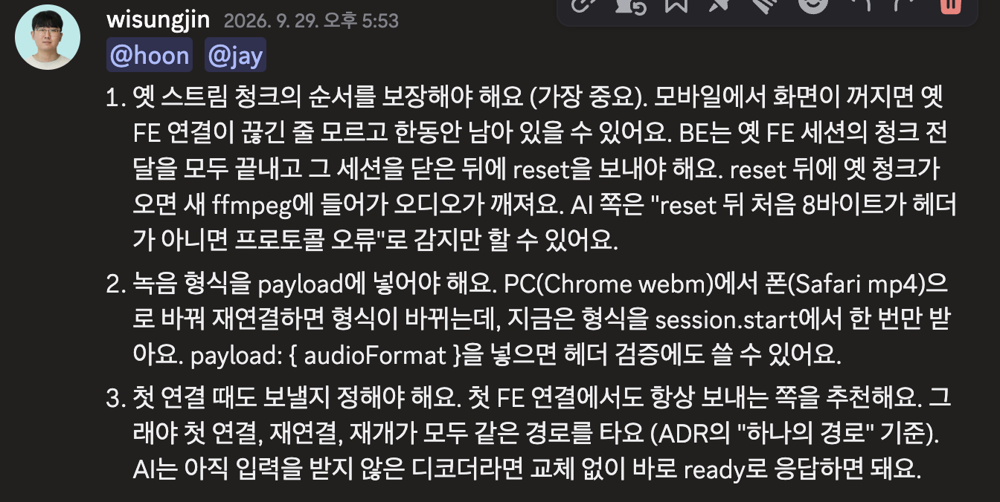
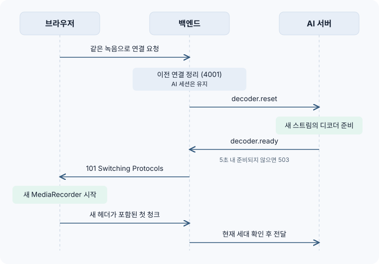

지난 [첫 번째 파이프라인 글](/posts/websocket-first-pipeline/)에 이어 두 번째 파이프라인에 대해 소개해드리려고 합니다.

## 테스터 : 새로고침하니까 전사가 안떠요…

지난 파이프라인에서는 브라우저가 받는 101 응답이 AI 서버의 Decoder 준비 완료까지 보장하도록 의미를 바꿨습니다. 덕분에 녹음 시작 직후 헤더가 담긴 첫 청크가 버려지는 문제는 해결을 했습니다.

이후 개발 서버에서 QA를 이어 가던 중, 테스터에게서 이런 제보가 들어왔습니다.


실제 회의에서 새로고침이나 연결 끊김은 흔한 일이라고 생각합니다. 모바일에서는 화면만 꺼져도 브라우저와 서버의 연결이 끊기고, 녹음 중이던 MediaRecorder도 함께 사라집니다. 그래서 녹음을 이어 가려면 새 MediaRecorder를 만들어, 같은 녹음으로 다시 연결해야 합니다.

재연결 자체는 성공한 것처럼 보였습니다. 브라우저는 다시 오디오를 보내고 있었지만, 재연결 이후의 전사는 화면에 한 줄도 올라오지 않았습니다.

## 녹음기는 새로 만들어지지만, 디코더는 그대로였다

원인을 찾으려면 먼저 브라우저가 보내는 오디오가 어떻게 생겼는지 알아야 합니다.

### MediaRecorder가 만드는 WebM 스트림

브라우저의 MediaRecorder는 녹음을 일정 간격으로 잘라 청크로 넘겨줍니다. 그런데 이 청크들은 각각이 완결된 오디오 파일이 아닙니다. 하나의 긴 WebM 파일을 순서대로 자른 조각입니다.

```text
[EBML 헤더 + 트랙 정보][Cluster][Cluster][Cluster] ...
└ 첫 청크에만 존재        └ 이후 청크: 헤더 없이 오디오 데이터만
```

- 첫 청크에는 "이 스트림은 Opus 코덱, 48kHz, 채널 1개"라는 헤더(EBML)가 담깁니다.
- 이후 청크에는 오디오 데이터만 있습니다. 첫 청크의 헤더를 알아야만 해석할 수 있습니다.

그래서 AI 서버는 청크를 하나씩 따로 디코딩하지 않습니다. 세션이 시작되면 ffmpeg 프로세스를 하나 띄우고, 도착하는 청크를 그 프로세스에 이어서 흘려 넣어 PCM으로 바꾼 뒤 STT로 보냅니다.

<iframe
  src="/embeds/audio-pipeline-session-ffmpeg-lifetime.html"
  title="기존 AI 세션과 ffmpeg 디코더의 수명"
  loading="lazy"
  style={{ width: '100%', height: '230px', border: 0, borderRadius: '14px' }}
></iframe>

### 새로고침하면 스트림이 하나 더 생긴다

새로고침하면 MediaRecorder가 사라집니다. 녹음을 이어 가려면 새 MediaRecorder를 만들어야 하고, 새 MediaRecorder는 헤더부터 다시 시작하는 새 스트림을 만듭니다.

하지만 AI 서버 입장에서는 같은 녹음, 같은 세션입니다. 디코더는 세션과 수명이 같으니, 새 스트림은 이미 첫 번째 헤더로 초기화된 기존 ffmpeg로 그대로 흘러 들어갑니다.

```text
기존 ffmpeg: [헤더A][Cluster][Cluster] ... [헤더B][Cluster][Cluster]
                                       └ 스트림 중간에 등장한 두 번째 헤더
```

당시 파이프라인의 기존 ffmpeg은 스트림 중간에 들어온 두 번째 헤더를 처리하지 못했습니다. 그 뒤로 들어오는 오디오는 디코딩되지 못하고 버려졌습니다. 연결은 정상이고 청크도 계속 도착하는데, STT까지 가는 오디오가 없으니 전사가 올라오지 않았습니다.

정리하면 원인은 하나였습니다.

> MediaRecorder의 수명과 AI 디코더(ffmpeg)의 수명이 맞지 않았다.

녹음기는 연결이 끊길 때마다 새로 태어나는데, 디코더는 세션이 끝날 때까지 그대로였습니다.

## 녹음기가 바뀌면 디코더도 바꾼다

원인이 수명의 불일치였으니, 해결도 수명을 맞추는 쪽이어야 했습니다. 방향은 두 가지였습니다.

- 재연결할 때마다 AI 세션을 새로 연다
- AI 세션은 그대로 두고, 디코더만 새로 만든다

AI 세션을 새로 열면 그동안 쌓인 회의 맥락(참석자, 화자 정보, 이전 전사와의 연결)이 끊깁니다. 그래서 세션은 녹음 내내 하나로 유지하고, 새 MediaRecorder가 생길 때마다 디코더만 교체하기로 AI 팀과 합의했습니다.



### 새 MediaRecorder = 새 WebSocket 연결

먼저 브라우저와 약속을 하나 정했습니다.

> 새 MediaRecorder를 만들 때는 항상 새 WebSocket 연결로 시작한다.

첫 연결, 새로고침 후 재연결, 일시정지 후 재개가 모두 같은 경로를 탑니다. 서버는 "새 연결이 왔다"는 사실만으로 "새 스트림이 시작된다"는 것을 알 수 있습니다.

### 101의 의미를 한 번 더 넓히다

지난 글에서 101 응답은 "AI 세션이 준비됐다"는 뜻이었습니다. 이번에는 여기에 "이 스트림을 위한 새 디코더가 준비됐다"까지 담았습니다.

1. 같은 녹음으로 이전 연결이 남아 있으면 정리합니다(4001로 종료).
2. AI 연결이 없으면 `session.start`로 세션을 엽니다. 있으면 그대로 씁니다.
3. AI에 `decoder.reset`을 보내 디코더 교체를 요청합니다.
4. AI가 `decoder.ready`로 답하면 그때 101을 보냅니다. 5초 안에 답이 없으면 503으로 거절합니다.



브라우저는 101을 받은 뒤에 MediaRecorder를 시작합니다. 그래서 새 헤더가 담긴 첫 청크는 항상 새 디코더의 맨 앞에 도착합니다.

### 이전 연결의 청크가 새 디코더로 섞이면

여기서 끝이 아니었습니다. 재연결 순간에는 이전 연결이 아직 완전히 끊기지 않았을 수 있습니다. 특히 모바일에서는 끊긴 줄 알았던 소켓이 뒤늦게 청크를 보내기도 합니다.

이전 스트림의 청크가 새 디코더로 들어가면, 이번에는 반대로 새 디코더가 헤더 없는 남의 데이터를 받게 됩니다.

그래서 연결마다 스트림 세대 번호를 붙였습니다.

- `decoder.reset`을 보낼 때 세대를 1 올립니다.
- 청크를 AI로 넘기기 전에, 그 청크를 보낸 연결의 세대가 현재 세대와 같은지 확인합니다.
- 세대가 다르면 이전 스트림의 청크로 보고 버립니다.
- 청크 전달과 `decoder.reset` 전송은 같은 Lock으로 묶어, reset과 청크가 엇갈려 도착하지 않게 했습니다.

## 배포했더니 녹음이 바로 끊겼다

이 변경을 개발 서버에 배포하자, 이번에는 녹음을 시작하자마자 연결이 끊긴다는 제보가 들어왔습니다.

원인은 이전 버전 FE였습니다. 이전 FE는 녹음을 시작할 때 오디오 WebSocket을 두 번 열고 있었습니다. 기존 서버는 두 번째 연결을 409로 거절했기 때문에 문제가 드러나지 않았습니다. 그런데 새 구조에서는 "새 연결 = 새 스트림"이라 두 번째 연결이 첫 번째 연결을 정리해 버렸습니다.

서버 변경을 먼저 되돌리고, FE와 연결 규칙을 다시 맞췄습니다.

- 오디오 WebSocket은 한 번만 연다
- 4001로 닫힌 소켓은 재연결하지 않고 조용히 끝낸다
- 101을 받은 뒤에 MediaRecorder를 시작한다
- 일시정지 후 재개는 녹음 상태 변경 요청을 먼저 보내고 새 연결을 연다

FE 배포가 끝난 뒤 같은 변경을 다시 적용했습니다.

> 서버가 그동안 막아 주던 동작은, 규칙을 바꾸는 순간 드러난다.

## 결과

새로고침하거나 연결이 끊겨도, 새 MediaRecorder가 만든 스트림은 새 디코더에서 처음부터 해석됩니다. 재연결 이후에도 전사가 이어서 올라오게 됐습니다.

## 그런데, 끊긴 사이의 소리는?

전사는 다시 올라오기 시작했지만, 아직 남은 문제가 있었습니다. 연결이 끊긴 순간 브라우저가 보내던 청크, 그리고 재연결까지 걸린 시간 동안의 소리는 어디로 갔을까요?

다음 글에서는 끊긴 사이의 청크를 잃지 않기 위해 만든 재전송 구조를 다룹니다.
